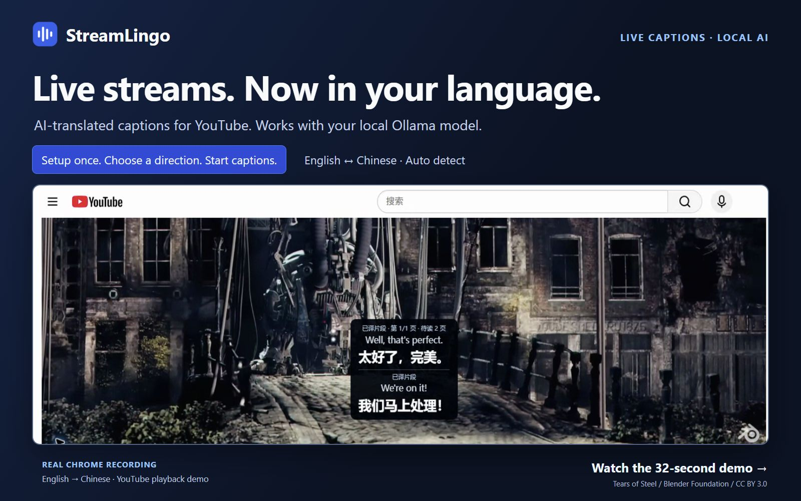
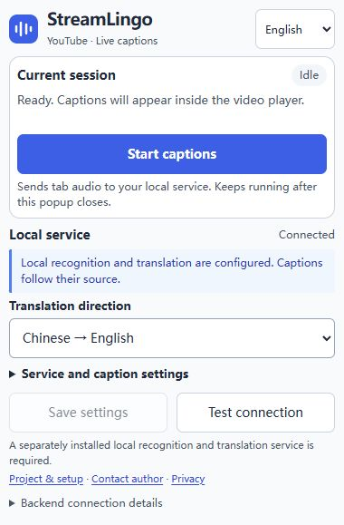

# StreamLingo

**Live streams. AI-translated.**

[简体中文](README.zh-CN.md) · [Getting started](docs/getting-started.md) · [Privacy](docs/privacy-policy.md) · [Report a bug](https://github.com/michael-chow-arch/StreamLingo/issues) · [MIT license](LICENSE)

**Real-time AI-translated captions for YouTube livestreams, with support for local LLMs.**

A YouTube livestream moves fast. When captions in your language are missing, it is easy to lose the thread of an interview, product launch, or live conversation.

StreamLingo generates **Chinese or English translations directly from livestream audio** and displays them inside the player. **No captions from the streamer are required.** It uses local speech recognition and the Ollama model you already run, while the original audio keeps playing.

**English → Chinese · Chinese → English · Auto → Chinese · Auto → English**

**Setup once. Start daily.** Already use Ollama? The prebuilt Windows preview needs no Node.js and starts with a double-click, without manual startup commands. A local Python companion and first-time speech dependency/model downloads are still required. The extension is installed manually; it is not yet listed in the Chrome Web Store.

**[Download the Windows preview](https://github.com/michael-chow-arch/StreamLingo/releases/download/v0.2.0/streamlingo-windows-0.2.0.zip)** · [Get started](#start-on-windows) · [System requirements](docs/runtime-requirements.md) · [Release notes](https://github.com/michael-chow-arch/StreamLingo/releases/tag/v0.2.0)

[](https://github.com/michael-chow-arch/StreamLingo/releases/download/v0.2.0/streamlingo-en-horizontal.mp4)

**[Watch the 32-second demo](https://github.com/michael-chow-arch/StreamLingo/releases/download/v0.2.0/streamlingo-en-horizontal.mp4)** · Real Chrome capture and actual English-to-Chinese captions, with English narration. The excerpt uses YouTube playback of an open film; it is not a livestream recording. [Footage credits](docs/video-production.md#footage-attribution--片段署名).

## What it does

- Generates captions from livestream audio captured directly from the browser tab. No microphone, speaker recording, or virtual audio cable is required.
- Offers English → Chinese, Chinese → English, and automatic source-language detection with either Chinese or English output.
- Uses your own Ollama model. The default local setup sends audio and text only to services on your machine.
- Translates stable segments during continuous speech, without requiring the speaker to stop.
- Displays complete translations in readable pages, with optional source text and adjustable font size.
- Continues capture when the popup closes. Start and stop remain under your control.

| Mode | Source speech | Subtitle language |
| --- | --- | --- |
| English → Chinese (default) | English | Simplified Chinese |
| Chinese → English | Chinese | English |
| Auto → Chinese | Detected by multilingual Whisper | Simplified Chinese |
| Auto → English | Detected by multilingual Whisper | English |

Automatic detection depends on the model and audio. Short clips, noise, accents, and mixed-language speech can cause mistakes; it does not guarantee accurate detection of every language switch. Use an explicit mode when you know the source language. The older English-only `base.en` model cannot provide the multilingual modes.

The same audio-based pipeline also works with regular YouTube videos.

## Start on Windows

You need **Chrome 116+** and **Ollama running with a local text model already installed**. The local service uses **Python 3.11–3.13**; setup can offer to install Python 3.12 through Windows Package Manager if none is found. Windows is the tested platform. Linux and macOS installation and live capture have not been validated.

The Windows speech service also requires an **NVIDIA GPU, CUDA 12 cuBLAS, and cuDNN 9 for CUDA 12**. The verified runtime combination is **CUDA 12.4.1 + cuDNN 9.3**. Check the [runtime requirements](docs/runtime-requirements.md) first; Setup does not install GPU drivers or CUDA/cuDNN.

1. Download and extract the **[Windows preview ZIP](https://github.com/michael-chow-arch/StreamLingo/releases/download/v0.2.0/streamlingo-windows-0.2.0.zip)**. It includes the built extension and needs no Node.js. The [release page](https://github.com/michael-chow-arch/StreamLingo/releases/tag/v0.2.0) includes its SHA-256 checksum. **Code → Download ZIP** and Git clones contain source code instead and require **Node.js 22+** to build the extension.
2. Double-click **`Setup-StreamLingo.cmd`**, with Ollama running. It lets you select an installed Ollama model, prepares the Python environment, downloads the multilingual Whisper `base` model, and builds the extension when needed. First setup needs internet access and can take a while; speech dependencies are large.
3. Double-click **`Start-StreamLingo.cmd`** and wait for the service to be ready. Keep Ollama running.
4. Open `chrome://extensions`, enable **Developer mode**, choose **Load unpacked**, and select **`dist/extension`** inside the project.
5. Open a playing YouTube livestream. Open StreamLingo from Chrome's toolbar, select a translation mode, test the connection, and start subtitles.

After setup, your daily routine is **Start-StreamLingo.cmd → open a YouTube livestream → Start subtitles in the popup**.

Use the popup's stop button to stop capture. **`Stop-StreamLingo.cmd`** stops the local subtitle service without stopping Ollama. Keep the project folder: the extension and launchers use files inside it. This is a local-service setup, not a standalone extension installation.

If something does not start, run **`Doctor-StreamLingo.cmd`** for local diagnostics. It does not upload logs. See the [installation guide](docs/getting-started.md) for model selection, updates, troubleshooting, and a lightweight demo that does not load speech or translation models.



*Demonstration settings. The interface is available in English and Simplified Chinese; interface language and translation direction are separate settings.*

## Measured on one local setup

RTX 3080 10 GiB, 32 GiB RAM, multilingual Whisper base and Ollama `qwen3.5:9b`, 2026-10-13. Original synthesized speech was sent in real time; caption scheduling was replayed separately.

| Test | Duration | Complete translations | Processing delay P95¹ | Reading wait P95² | Translation failures / skips |
| --- | ---: | ---: | ---: | ---: | ---: |
| English → Chinese | 30m 23s | 672 | 2.414 s | 3.859 s | 0 / 0 |
| Chinese → English | 30m 16s | 675 | 3.172 s | 6.120 s | 0 / 0 |

¹ Reported speech-segment end to receipt of its translation. ² Completed translation receipt to first display, measured by offline scheduler replay. Neither is Chrome end-to-end latency. These results do not measure translation accuracy or establish minimum hardware. See [full measurements, definitions and reproduction steps](docs/benchmarks.md).

## How subtitles behave

Completed translations are displayed automatically in order. Long translations split at sentence or word boundaries where possible, preserving their text across pages. Each page or group stays visible for at least four seconds; two adjacent short translations can share a reading interval. The final page disappears after twelve seconds if no new page arrives.

Already completed translations are not discarded just because the reader is behind. Fast speech can therefore build up a visible subtitle delay. Switching to another tab pauses the reading timer while capture and incoming translations continue. Returning resumes the reading time. There is no history panel or manual paging. Stopping, refreshing the page, changing videos, or starting a new session clears the queue.

This applies to translations that successfully finish. Recognition errors, slow inference, translation timeouts, and the bounded backend work queue can still leave speech untranslated. If translation fails, available source text remains available to display. This is not a guarantee that every spoken word will be translated.

## Local processing and requirements

```text
YouTube tab audio
  → Chrome tabCapture + AudioWorklet
  → local WebSocket service (PCM16, mono, 16 kHz)
  → WhisperLiveKit / faster-whisper
  → Ollama
  → subtitles in the YouTube player
```

The default service listens on `127.0.0.1:8765` and uses Ollama at `127.0.0.1:11434`. StreamLingo has no hosted translation service, account, or built-in analytics. Dependency and model downloads need internet access; YouTube itself remains an online service. Configuring a non-local Ollama endpoint sends recognized text to that endpoint.

Live performance depends on hardware and models. Speech recognition and Ollama can compete for GPU memory and compute. No universal real-time speed or minimum GPU is promised. Only one capture session is supported per local service. See [security and privacy boundaries](SECURITY.md) before sharing logs or changing deployment settings.

The Windows preview's supported GPU setup requires CUDA 12.x with cuBLAS and cuDNN 9.x for CUDA 12, visible to the service process. Missing runtime files produce an actionable error; StreamLingo does not automatically switch to CPU. See the [runtime requirements](docs/runtime-requirements.md) before setup.

## Develop and contribute

| Directory | Responsibility |
| --- | --- |
| `extension/` | Chrome popup, capture, session control, and subtitles |
| `backend/` | Local service, speech recognition, and translation |
| `packages/protocol/` | Shared message types and runtime validation |
| `scripts/` | Setup, launchers, build, and regression utilities |
| `docs/` | Setup, architecture, protocol, and validation notes |

For model-free development checks:

```sh
npm ci
npm run check
python -m venv backend/.venv
# Activate the virtual environment using your shell, then:
python -m pip install -e "./backend[test]"
python -m pytest backend/tests -q
```

These checks do not install the optional speech stack or call Ollama. Passing them does not establish real-model accuracy or Chrome capture compatibility on a new platform.

Read [CONTRIBUTING](CONTRIBUTING.md), the [architecture](docs/architecture.md), [protocol](docs/protocol.md), and [validation notes](docs/validation.md). Bug reports, installation feedback, and focused pull requests are welcome. Please use original or permission-cleared audio for reproducible examples.

## License and contact

Created and maintained by [michael-chow-arch](https://github.com/michael-chow-arch). Follow development and share feedback in the [StreamLingo repository](https://github.com/michael-chow-arch/StreamLingo), or contact [michael.chow.tech@gmail.com](mailto:michael.chow.tech@gmail.com).

StreamLingo is released under the [MIT License](LICENSE). Dependencies and model weights retain their own licenses.
