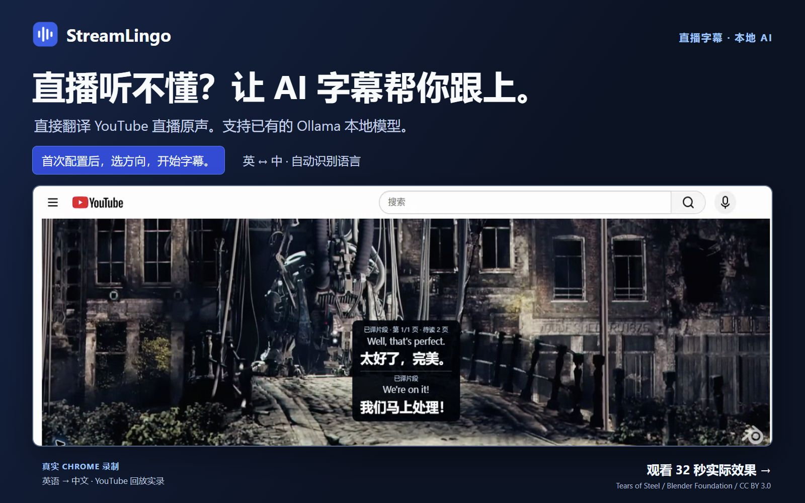
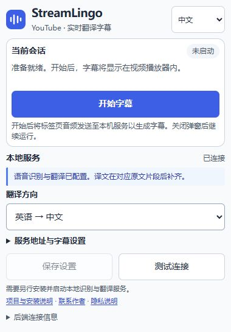

# StreamLingo

**让 YouTube 直播说你的语言。**

[English](README.md) · [安装指南](docs/getting-started.md) · [隐私说明](docs/privacy-policy.md) · [反馈问题](https://github.com/michael-chow-arch/StreamLingo/issues) · [MIT 许可](LICENSE)

**YouTube 直播实时 AI 翻译字幕，支持本地大模型。**

想看 YouTube 直播里的访谈、发布会或现场交流，却没有你需要的中文或英文字幕，很容易错过正在发生的内容。

StreamLingo **直接从直播原声生成中文或英文翻译字幕**，显示在播放器内。**无需主播提供字幕**，通过本地语音识别和你已有的 Ollama 模型完成翻译，原声照常播放。

**英译中 · 中译英 · 自动识别后译中 · 自动识别后译英**

**首次配置，日常双击启动。** 已有 Ollama 的用户可使用 Windows 预构建包，无需 Node.js，也无需手动敲启动命令。首次仍需配置本地 Python 服务并下载语音依赖和模型；扩展需手动加载，尚未上架 Chrome 应用商店。

**[下载 Windows 预览版](https://github.com/michael-chow-arch/StreamLingo/releases/download/v0.2.0/streamlingo-windows-0.2.0.zip)** · [开始使用](#windows-快速开始) · [运行条件](docs/runtime-requirements.md) · [更新说明](https://github.com/michael-chow-arch/StreamLingo/releases/tag/v0.2.0)

[](https://github.com/michael-chow-arch/StreamLingo/releases/download/v0.2.0/streamlingo-zh-CN-horizontal.mp4)

**[观看 32 秒实际效果](https://github.com/michael-chow-arch/StreamLingo/releases/download/v0.2.0/streamlingo-zh-CN-horizontal.mp4)** · 真实 Chrome 录制、实际英译中字幕与中文解说。演示使用开放电影的 YouTube 回放，并非直播录屏。[片段来源与署名](docs/video-production.md#footage-attribution--片段署名)。

## 主要功能

- 直接拾取浏览器标签页的直播音频并生成字幕，无需麦克风、扬声器录音或虚拟声卡。
- 支持英译中、中译英，以及自动识别源语言后翻译为中文或英文。
- 使用你自己的 Ollama 模型；默认配置下，音频和识别文本仅发送给本机服务。
- 持续讲话时也按稳定短片段进行翻译，无需等说话者停下来。
- 完整译文自动分页展示，可选显示原文并调整字号。
- 关闭弹窗后继续采集，通过扩展主动开始或停止。

| 翻译模式 | 源语音 | 字幕语言 |
| --- | --- | --- |
| 英语 → 中文（默认） | 英语 | 简体中文 |
| 中文 → 英语 | 中文 | 英语 |
| 自动 → 中文 | 由多语 Whisper 检测 | 简体中文 |
| 自动 → 英语 | 由多语 Whisper 检测 | 英语 |

自动检测的效果取决于 Whisper 模型和音源。短语音、噪声、口音以及混合语言可能导致错误，不保证逐句准确跟随语言切换。已知源语言时，优先选择明确的方向。旧的英语专用 `base.en` 模型不支持多语模式。

同样的音频处理流程也兼容普通 YouTube 视频。

## Windows 快速开始

需要 **Chrome 116+**，以及**已启动且已有本地文本模型的 Ollama**。本地服务使用 **Python 3.11–3.13**；未找到 Python 时，安装脚本可提示通过 Windows 包管理器安装 Python 3.12。目前验证过 Windows；Linux、macOS 的安装和实时采集尚未验证。

Windows 语音服务还需要 **NVIDIA GPU、CUDA 12（含 cuBLAS）和适用于 CUDA 12 的 cuDNN 9**。已验证组合是 **CUDA 12.4.1 + cuDNN 9.3**。请先查看[运行条件](docs/runtime-requirements.md)；Setup 不自动安装显卡驱动或 CUDA/cuDNN。

1. 下载并解压 **[Windows 预览版 ZIP](https://github.com/michael-chow-arch/StreamLingo/releases/download/v0.2.0/streamlingo-windows-0.2.0.zip)**，其中已包含构建好的扩展，无需安装 Node.js。[发布页](https://github.com/michael-chow-arch/StreamLingo/releases/tag/v0.2.0)同时提供 SHA-256 校验文件。仓库的 **Code → Download ZIP** 或 Git 克隆获取的是源码，需要 **Node.js 22+** 来构建扩展。
2. 保持 Ollama 运行，双击 **`Setup-StreamLingo.cmd`**：选择已有 Ollama 模型、准备 Python 环境、下载多语 Whisper `base` 模型，并在需要时构建扩展。首次安装需要联网，语音识别依赖较大，请等待完成。
3. 双击 **`Start-StreamLingo.cmd`**，等待服务就绪，保持 Ollama 运行。
4. Chrome 打开 `chrome://extensions`，开启**开发者模式**，点击**加载已解压的扩展程序**，选择项目中的 **`dist/extension`** 文件夹。
5. 打开正在播放的 YouTube 直播，从工具栏打开 StreamLingo，选择翻译方向，测试连接后开始字幕。

配置完成后，日常只需 **双击 Start-StreamLingo.cmd → 打开 YouTube 直播 → 在弹窗点击开始字幕**。

扩展中的停止按钮用于停止采集。双击 **`Stop-StreamLingo.cmd`** 可停止本地字幕服务，不会停止 Ollama。请保留解压后的项目文件夹，扩展和启动脚本仍需要使用它。首次安装仍需准备本地服务，并非只装扩展就能运行。

无法启动时，双击 **`Doctor-StreamLingo.cmd`** 查看本机诊断，不会上传日志。模型选择、升级、常见问题和无需加载大模型的测试模式，见[安装指南](docs/getting-started.md)。



*弹窗使用演示设置。界面支持中文和 English；界面语言与翻译方向分别设置。*

## 本机实测数据

测试日期 2026-10-13；RTX 3080 10 GiB 显存、32 GiB 内存，多语 Whisper base + Ollama `qwen3.5:9b`。原创合成语音按真实速度送入模型，字幕显示另通过生产调度器离线回放验证。

| 测试方向 | 音频时长 | 完成译文 | 处理延迟 P95¹ | 阅读等待 P95² | 翻译失败 / 跳过 |
| --- | ---: | ---: | ---: | ---: | ---: |
| 英语 → 中文 | 30 分 23 秒 | 672 | 2.414 秒 | 3.859 秒 | 0 / 0 |
| 中文 → 英语 | 30 分 16 秒 | 675 | 3.172 秒 | 6.120 秒 | 0 / 0 |

¹ 识别片段的结束时间到收到译文。² 收到完整译文后到首次显示的额外等待，由字幕调度器离线回放测量。两者都不是 Chrome 端到端延迟，也不代表翻译准确率或最低硬件要求。P95 表示 95% 的测量值不超过该值。详见[完整性能表、指标定义与复现方法](docs/benchmarks.md)。

## 字幕如何显示

已完成的译文依次自动显示。长译文优先按句子或词语边界分页，分页前后的完整文字保持一致。每页或每组至少显示四秒；相邻的两条短译文可以合并在同一个阅读周期内展示。没有后续内容时，最后一页在显示十二秒后隐藏。

已经完成的译文不会仅因积压或等待较久而被丢弃。因此，讲话快于阅读速度时，字幕延迟会逐渐增加。切到后台标签页后，阅读计时暂停，采音和接收译文仍继续；回来后恢复阅读时间。界面不提供历史面板或手动翻页。停止、刷新页面、切换视频或开始新会话会清空当前字幕和等待队列。

以上保证只针对成功返回的完整译文。识别错误、推理较慢、翻译超时以及后端有界任务队列，仍可能造成部分声音没有翻译。翻译失败时，可用的源语言文字仍可显示；这不代表每个词都一定能被识别和翻译。

## 本地处理与运行要求

```text
YouTube 标签页音频
  → Chrome tabCapture + AudioWorklet
  → 本地 WebSocket 服务（PCM16、单声道、16 kHz）
  → WhisperLiveKit / faster-whisper
  → Ollama
  → YouTube 播放器内字幕
```

默认字幕服务位于 `127.0.0.1:8765`，Ollama 位于 `127.0.0.1:11434`。StreamLingo 没有托管翻译服务、账号系统或内置使用统计。安装依赖和下载模型需要联网，YouTube 本身仍是在线服务。如果将 Ollama 改为远程地址，识别文本会发送到该地址。

实时效果取决于硬件和模型。语音识别与 Ollama 可能争用 GPU 显存和算力，不承诺所有机器都有同样的实时速度，也没有通用最低 GPU 保证。每个本地服务只支持一个采集会话。分享日志或调整部署方式前，请阅读[安全与隐私边界](SECURITY.md)。

Windows 预览版支持的 GPU 运行环境需要 CUDA 12.x（含 cuBLAS）和适用于 CUDA 12 的 cuDNN 9.x，且服务进程能够找到这些运行库。缺少时明确提示缺项，不自动改用 CPU。安装前请检查[运行条件](docs/runtime-requirements.md)。

## 开发与贡献

| 目录 | 职责 |
| --- | --- |
| `extension/` | Chrome 弹窗、采音、会话协调与字幕 |
| `backend/` | 本地服务、语音识别与翻译 |
| `packages/protocol/` | 共享消息类型与运行时校验 |
| `scripts/` | 安装、启动、构建与回归验证工具 |
| `docs/` | 安装、架构、协议和验证记录 |

开发环境准备及无需大模型的检查命令见 [CONTRIBUTING](CONTRIBUTING.md)。也可阅读[架构](docs/architecture.md)、[协议](docs/protocol.md)和[验证记录](docs/validation.md)。欢迎提交安装反馈、可复现问题与范围明确的改进。回归音源请使用原创内容或有权分享的内容。

## 许可与联系

由 [michael-chow-arch](https://github.com/michael-chow-arch) 创建和维护。欢迎在 [StreamLingo 仓库](https://github.com/michael-chow-arch/StreamLingo)关注进展与反馈，或联系 [michael.chow.tech@gmail.com](mailto:michael.chow.tech@gmail.com)。

项目采用 [MIT 许可证](LICENSE)。依赖和模型权重遵循各自的许可。
